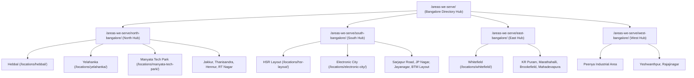

# SEO LOCATION ARCHITECTURE: BANGALORE-WIDE COVERAGE
## SAM FABRICATION ENGINEERING WORK (https://samfabrication.in)

---

## 1. Executive Strategy & Anti-Doorway Compliance

To comply with Google Search Essentials regarding localized doorway pages, SAM Fabrication employs a **Hub-and-Spoke Regional Entity Architecture** rather than automated city-swapped template pages.

### Core Principles
1. **Zero Automated Doorways:** Every regional corridor page (`/areas-we-serve/*`) and specific locality page (`/locations/*`) contains verified engineering distinctions, real architectural challenges, specific material recommendations, and genuine project evidence.
2. **Single Physical Anchor NAP:** SAM Fabrication does not invent fake virtual offices or fraudulent branch addresses. All service is anchored to the primary workshop hub on the Hebbal / Bellary Road Industrial Corridor (560024), providing mobile measurement teams and workshop transport across Bangalore.
3. **Structured Area Served Schema:** Regional and locality URLs utilize Schema.org `Service` and `AdministrativeArea` structured data to establish authentic topical and geographical relevance without manipulative tactics.

---

## 2. URL Structure & Cardinal Corridors

---

## 3. Corridor Profiles & Engineering Demands

### A. North Bangalore Hub (`/areas-we-serve/north-bangalore/`)
- **Primary Keyword:** `fabrication works north bangalore`
- **Assessed Localities:** Hebbal, Yelahanka, Jakkur, Thanisandra, Hennur, RT Nagar.
- **Urban & Architectural Context:** Rapidly expanding residential gateway leading to Kempegowda International Airport. Characterized by independent villas, gated townships, high-rise tech parks (Manyata), and large frontage properties.
- **Specific Fabrication Demands:**
  - Automated sliding and telescoping driveway gates.
  - High wind-load resistant terrace roofing and solar panel support sheds.
  - Grade 304 stainless steel and toughened glass balcony balustrades.
  - Minimalist floating open-riser metal staircases.
- **Verified Project Milestones:**
  - Hebbal Villa: Solid CRCA horizontal bar safety window grills.
  - Manyata Tech Park: AISI 304 SS hairline satin balcony railings.
  - Yelahanka Duplex: Internal 200x100mm mono-stringer floating metal staircase.

### B. South Bangalore Hub (`/areas-we-serve/south-bangalore/`)
- **Primary Keyword:** `fabrication works south bangalore`
- **Assessed Localities:** HSR Layout, Sarjapur Road, Electronic City, JP Nagar, Jayanagar, BTM Layout.
- **Urban & Architectural Context:** Historic cultural residential enclaves (Jayanagar, JP Nagar) merged with dense modern residential sectors (HSR Layout) and premier IT/industrial clusters (Electronic City Phase 1 & 2).
- **Specific Fabrication Demands:**
  - Fascia side-mounted balcony railings that preserve 100% of usable floor space on compact balconies.
  - Space-saving bi-folding and cantilever driveway gates.
  - Heavy structural steel PEB warehouse framing and crane gantry girders in Electronic City.
  - Certified external fire escape staircases and egress platforms.
- **Verified Project Milestones:**
  - HSR Layout Residence: Architectural matte black powder-coated mild steel balcony railings.
  - Electronic City Industrial: PEB warehouse clear-span roof trusses and perimeter security gates.

### C. East Bangalore Hub (`/areas-we-serve/east-bangalore/`)
- **Primary Keyword:** `fabrication works east bangalore`
- **Assessed Localities:** Whitefield, KR Puram, Marathahalli, Brookefield, Mahadevapura.
- **Urban & Architectural Context:** Cosmopolitan tech epicenter featuring expansive gated villa townships, ITPL campus enclaves, and corporate headquarters. High premium placed on contemporary design minimalism and luxury finishes.
- **Specific Fabrication Demands:**
  - CNC precision laser-cut main gates with wood-finish or champagne gold inserts.
  - Marine-grade AISI 316 stainless steel railings for maximum exterior longevity.
  - Drop-off entrance glass canopies with architectural spider fittings.
  - Cantilever polycarbonate multi-car parking shades.
- **Verified Project Milestones:**
  - Whitefield Corporate Office: Bespoke 0.1mm fiber-laser cut decorative metal partition screens.
  - Sarjapur Villa: Heavy structural portico entrance canopy with laminated safety glass and timber slats.

### D. West Bangalore Hub (`/areas-we-serve/west-bangalore/`)
- **Primary Keyword:** `fabrication works west bangalore`
- **Assessed Localities:** Peenya Industrial Area, Yeshwanthpur, Rajajinagar.
- **Urban & Architectural Context:** The manufacturing and logistical core of Karnataka, anchored by Peenya Industrial Area—one of South Asia's largest industrial estates—alongside traditional commercial hubs in Rajajinagar and logistics depots in Yeshwanthpur.
- **Specific Fabrication Demands:**
  - Heavy structural steel fabrication compliant with IS 800 standards (ISMB/ISMC sections).
  - Industrial open-web Pratt and Warren roof trusses up to 30-meter clear spans.
  - Factory mezzanine storage platforms and heavy equipment support skids.
  - Anti-corrosive zinc-rich epoxy primers for aggressive industrial atmospheres.
- **Verified Project Milestones:**
  - Bidadi Industrial Warehouse: 6,200 sq ft structural steel warehouse framing and crane beams.
  - Nelamangala Plant: 18-meter clear-span industrial roof truss fabrication and crane erection.

---

## 4. Google Business Profile & Local SEO Implementation

1. **GBP Optimization:**
   - Primary Category: `Metal Fabricator`
   - Secondary Categories: `Welder`, `Iron Works`, `Steel Fabricator`, `Railing Contractor`, `Shed Builder`
   - Service Area: Bangalore Urban & Bangalore Rural (covering all 20 listed localities).
2. **Local Citation Hygiene:**
   - Consistent Name: `SAM Fabrication Engineering Work`
   - Consistent Phone: `+91 94533 44824`
   - Consistent Address: `Dasarahalli Main Road Near Sobha Moonstone, Bangalore, Karnataka 560024`
3. **On-Site Measurement Dispatch:**
   - Mobile teams equipped with digital laser distance meters and material finish catalogs.
   - Guaranteed same-day or next-day site consultations across North, South, East, and West Bangalore.

